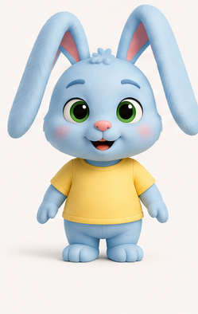

# Mimi First Frame Stage 2 — Canonical Reference and Stronger Opening

**Character asset result:** `CLEAN_CROP_PREPARED_FOR_OWNER_REVIEW`; canonical approval is still `NOT_APPROVED`.

**Opening result:** A mid-peel frame showing one complete note visibly duplicating into two is a concrete, testable alternative. The static hypothesis remains `STATIC_CAUSAL_LEGIBILITY: UNPROVEN`; no image has been generated or visually tested. If one authorized frame test still reads as tearing, peeling apart stacked notes, or two ordinary notes, reject this concept for the production track rather than continuing cosmetic prompt revisions.

## 1. Mimi asset verification

The live application's read-only endpoints were checked again on 2026-10-18. The approved Mimi reference list is empty. Workspace discovery still returns `library/01-CHARACTERS/drawings/mimi.png` with status `UNREVIEWED`.

| Asset | Location | SHA-256 | State |
|---|---|---|---|
| Original Mimi model sheet | Application data root: `library/01-CHARACTERS/drawings/mimi.png` | `7ad3d0042965c53ae20c67c0242d49cec2d3cf43706915d715b4fadec3c59f57` | `UNREVIEWED`; not canonically approved |
| Clean single-character crop | [mimi-reference-clean-crop-owner-review.png](mimi-sticky-first-frame/mimi-reference-clean-crop-owner-review.png) | `80e0579ac5979be010da5c7250debbe9e74e84b37661d7a2213f24e055e49f14` | Local derivative for owner review only; not approved or bound |
| Provenance manifest | [mimi-reference-clean-crop-provenance.json](mimi-sticky-first-frame/mimi-reference-clean-crop-provenance.json) | — | Records source hash, crop coordinates, method, and unapproved state |

The derivative is a 249 × 394 RGB PNG cropped from the isolated full-body Mimi image in the upper-left panel of the source sheet. Crop box: `[12, 108, 261, 502]` in source-image pixel coordinates. This is a pixel crop only: no resizing, retouching, compositing, color adjustment, or generative alteration. The resulting image shows one complete light-blue rabbit, including ears and feet, with no labels or other characters. It remains a modest-resolution crop; its use as a generation reference still requires owner review.

The image and manifest are not registered in the application. No upload/import/approval API was called, and no database row or canonical binding was created. The original asset remains `UNREVIEWED`; owner approval must target the exact candidate version and hash. Approval of the original sheet does not automatically approve the derivative, and vice versa.

## 2. Source and preservation check

The prospective Mimi source remains [source-revision-mimi-sticky-note-v1.txt](canonical-character-correction/source-revision-mimi-sticky-note-v1.txt), local revision `LOCAL-CANONICAL-CHARACTER-CORRECTION-PIP-TO-MIMI-V1`. Its prompt-body SHA-256 was recomputed and matches the expected value:

`6e51187223efc4c5f8e6b067fa3ab627aba583d6db4e1b33d0d1bf4665d18c3a`

The revision remains unapproved and undeployed. No source file was overwritten. The historical V6.3 Pip record, findings, hashes, and receipts were not changed. V6.3 remains evidence about the historical Pip source and A/B variations; it is not a review of this prospective Mimi opening.

## 3. One proposed revised opening

`UNAPPROVED_CREATIVE_OPENING_PROPOSAL`

At frame zero, Mimi is already trying to peel the single sticky note from her paw. The intact original note remains attached to the paw while a second complete, identical note is visibly emerging from the same adhesive contact as the peel begins. Both square outlines and all four corners must read as complete; there is no torn edge. The toy cabinet remains clearly visible as the intended destination, with its target panel untouched. Mimi looks directly at the impossible pair. No other note is present.

**What changes:** the first visible moment moves from the placement attempt and one note stuck to Mimi to the first peel/multiplication action already underway. The preceding placement and wrong-surface event would have happened immediately before the clip or be conveyed through the cabinet target and Mimi’s action. This changes the visible opening event/timing and needs explicit owner approval.

**Protected story anchors retained in the proposal:** Mimi remains the light-blue rabbit; the cabinet remains the cleanup target; the same one-rule multiplication progresses 1→2→4→8 through attempts; Mimi recognizes the consequence, stops struggling, sneezes the notes onto the cabinet, and ends relieved while the cabinet remains messy. No extra character, prop, or physical rule is added. This proposal has not been applied to the source.

## 4. Static hypothesis and risks

| Question | Assessment before pixels |
|---|---|
| Can one still convey duplication without prior movement? | **Plausible, not proven.** A frozen state can show one intact note producing a second complete copy at the peel contact. This must read from shape and origin alone. |
| Is source versus duplicate distinguishable? | **High risk.** Use one note held against Mimi’s paw and one intact copy emerging at a visibly offset angle from the same contact. If both look like a pre-stacked pair, fail. |
| Could it look torn or peeled? | **Yes; major risk.** Torn-paper edges, folds, creases, a shared ripped seam, or a copy hidden behind the source destroy the claim. Both notes need complete, unbroken square outlines. |
| Is Mimi’s reaction readable? | **Plausible.** Turn her eyes toward the pair and use a clear surprised expression while preserving her owner-approved likeness. Pixels remain untested. |
| Is the cabinet relevant? | **Yes if visible and empty.** Keep its target panel in frame; it establishes the attempted destination but must not compete with the note pair. |
| Does the problem require counting? | **It should not.** The viewer should see the second intact copy emerging from the first. Merely displaying two notes is insufficient. |
| Can it survive 480p? | **Unproven; high detail risk.** Give each note a broad, complete silhouette, strong value contrast, and enough area to read at a 480px-tall preview. The contact/origin must remain visible after reduction. |
| Thin-paper/Seedance risk | **High.** Seedance may tear, fold, fuse, stack, duplicate unpredictably, or lose count. The opening is visually testable, but animation continuity remains a separate unknown. |

`STATIC_CAUSAL_LEGIBILITY: UNPROVEN`

The composition is plausible enough for one decisive, separately authorized image test because the impossible state would be visible in the still itself. The prompt is not evidence. If the resulting pixels do not clearly show intact duplication from the peel contact without explanatory graphics, reject this production track; do not keep adjusting camera or adjective choices to force a pass.

## 5. Five-beat storyboard — unapproved proposal

Target: 15 seconds, vertical 9:16. The storyboard changes only the first visible moment; all later beats preserve the prospective source’s event order and ending.

| Time | Beat and visible consequence |
|---|---|
| 0–2s | **Start on 1→2.** Mimi is already peeling the first note from her paw; a second complete, identical note visibly emerges from that contact. Keep the cabinet target visible and untouched. Hold the two intact outlines long enough to read. |
| 2–5s | Mimi tries to press the pair onto the cabinet. They spring back; the two notes double into four. Keep the four as distinct broad squares and preserve Mimi’s paw-to-note contact. |
| 5–8s | Mimi tries to push the four notes off against the cabinet door edge. They double into eight and spread over her arms, legs, and parts of her face; keep eyes and mouth readable. Do not add another attempt or exceed eight. |
| 8–11s | The 4→8 change finishes. Mimi stops struggling, holds still, recognizes the consequence, and turns her still note-covered face toward the mirror. Keep the note coverage unchanged. This is a deliberate quiet beat, not another escalation. |
| 11–15s | Mimi sneezes once. The eight notes scatter and stick to the cabinet. Allow the scatter to finish before the final relief hold; Mimi breathes out, while the cabinet remains visibly messy. Do not add extra notes, a second sneeze, or a new final gag. |

**Difference from current prospective source:** only frame-zero/first-visible timing changes. The single-note placement/contact event precedes the clip rather than opening on screen; the first displayed event is the initial peel and 1→2 consequence. Later counts, failed attempts, realization/stillness, sneeze, relief, and messy cabinet stay in order. Owner approval is required before changing the source.

## 6. Image-generation handoff — do not dispatch yet

**Reference identifier/path:** `intelligence/docs/mimi-sticky-first-frame/mimi-reference-clean-crop-owner-review.png`
**Derivative SHA-256:** `80e0579ac5979be010da5c7250debbe9e74e84b37661d7a2213f24e055e49f14`
**Source path:** `library/01-CHARACTERS/drawings/mimi.png`
**Source SHA-256:** `7ad3d0042965c53ae20c67c0242d49cec2d3cf43706915d715b4fadec3c59f57`
**Canonical character ID:** `00000000-0000-0000-0000-000000000003`
**Approval:** Source `UNREVIEWED`; derivative `UNAPPROVED_DERIVATIVE_OWNER_REVIEW_ONLY`; neither is canonically bound.

Use the following prompt only after the owner explicitly approves the exact clean derivative and separately approves the opening-story change. No OpenArt/image-generation request was made.

> Create one polished family-friendly 3D animated still in vertical 9:16 for an image-to-video short intended for OpenArt first-frame creation and Seedance 2.0 Mini. Use the attached owner-approved Mimi character reference as the sole authority for Mimi’s exact face, fur, proportions, ears, clothing, colors, materials, and silhouette. Preserve her design exactly; do not redesign her or substitute another rabbit. Compose a stable 3/4 close-medium shot in a simple playroom. Show Mimi from mid-torso up on the left, with her paws and a single sticky-note contact large in the center foreground. Keep an empty toy-cabinet target panel clearly visible on the right. Frame zero begins during the first peel attempt: one intact square sticky note is attached to Mimi’s paw, and a second complete, identical square note is visibly emerging from the first note’s adhesive contact as Mimi gently pulls. Show the impossible 1→2 duplication in this still: both notes have separate, complete, unbroken outer edges and four readable corners; the source note remains attached to Mimi while the duplicate is offset far enough to distinguish, but visibly originates at the same contact. Do not depict paper tearing, folding, or two notes that were already stacked. Mimi looks directly at the pair with immediate surprise. Her free paw remains away from the note; the cabinet panel is untouched. Keep the cabinet as context, not as a second focal subject. Use a clean neutral background, simple lighting, strong value contrast around both note silhouettes and Mimi’s paw, and no motion blur. Make the note pair large enough to remain readable in a 480-pixel-tall phone preview. Keep the frame uncluttered and suitable as the stable first state for a 15-second image-to-video sequence.
>
> **Negative constraints:** no generic rabbit, no character redesign, no extra character, no extra note beyond the two shown, no torn edge, no ripped paper, no folds, no creases, no paper strips, no pre-stacked pair, no detached floating note, no note stuck to the cabinet, no cabinet deformation, no arrows, no labels, no captions, no lettering, no text, no overlay, no split screen, no inset showing prior motion, no motion streaks, no sparkle or magical aura, no unrelated prop, no clutter, no fused paws, no extra fingers/limbs, and no cropped note corners or Mimi’s face.

The source note and duplicate must be visually separate enough to count without relying on tiny edge details, but clearly connected by the visible peel-origin relationship. This remains a difficult image-generation instruction, not proof that a model can render it.

## 7. 480p inspection and expected Seedance start state

For the eventual single image test, inspect actual pixels at native size and at 480px frame height:

- Is the exact approved Mimi likeness preserved?
- Are there exactly two complete notes, with four corners visible on each?
- Can an observer distinguish one source note and one emerging duplicate without a caption or prior frame?
- Is the shared peel-origin relationship visible, with no tear, fold, stack, or ordinary pair interpretation?
- Is Mimi’s reaction visible and directed at the notes?
- Is the cabinet target visible and untouched?
- Does the note pair remain readable on a phone-sized 9:16 view?
- Is the image uncluttered, and does it avoid copied labels/props from the model sheet?
- Can the still plausibly seed a continuous transition from two to four and then eight notes without changing note identity?

All remain `NOT_EVALUATED` until a real image exists. A still cannot establish successful Seedance motion. Expected start state: two intact notes at the paw/cabinet staging, Mimi mid-peel, cabinet empty; first motion continues from this exact state into the two-to-four beat without resetting to one note or adding a third.

## 8. Decisions and exact next action

Two separate owner decisions are required:

1. **Character approval:** inspect the clean crop and approve or reject the exact derivative SHA-256 `80e0579ac5979be010da5c7250debbe9e74e84b37661d7a2213f24e055e49f14` as Mimi’s canonical visual reference, or provide an alternative. The original sheet’s hash is `7ad3d0042965c53ae20c67c0242d49cec2d3cf43706915d715b4fadec3c59f57`. Approval of one is not approval of the other.
2. **Opening-story approval:** approve or reject beginning the visible clip on the first peel/1→2 multiplication, which changes the first visible event while retaining later protected anchors.

If both are approved, the next executable image step is **one** OpenArt first-frame generation using the exact derivative and prompt above, followed by a 480p/phone-scale visual inspection. This task did not authorize that provider call; obtain separate explicit authorization before dispatch. If the one image is causally ambiguous, reject the concept for this production track rather than iterating cosmetically. A later Seedance motion test requires separate authorization.

## 9. Integrity

The source and derivative hashes were verified locally. The derivative is linked to its source by the JSON provenance manifest. No generative image alteration, provider call, production database write, reference import/approval, production deployment, source edit, historical V6.3 edit, prompt version creation, grading activation, or video generation occurred.
