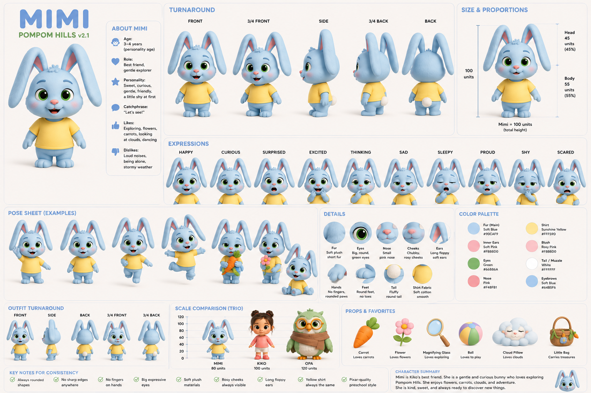

# Mimi Sticky Notes — First Frame Stage 1

**Decision:** `FIRST_FRAME_STATIC_CAUSAL_LEGIBILITY: FAIL` for both source-faithful compositions. The source-faithful first frame can show where the note sticks, but a note adhering to a fingertip is ordinary physical behavior in a still. Mimi’s reaction and the empty cabinet can imply a failed attempt; they do not prove the multiplying rule or an impossible event.

**Character asset:** exact Mimi workspace image found and hash-verified; status remains `UNREVIEWED`. No approval or character binding was created. This package contains no generated image and makes no pixel-based PASS claim.

## 1. Authoritative source and historical boundary

The corrected prospective source is [source-revision-mimi-sticky-note-v1.txt](canonical-character-correction/source-revision-mimi-sticky-note-v1.txt), local revision `LOCAL-CANONICAL-CHARACTER-CORRECTION-PIP-TO-MIMI-V1`. Its prompt-body SHA-256 was recomputed as:

`6e51187223efc4c5f8e6b067fa3ab627aba583d6db4e1b33d0d1bf4665d18c3a`

The source names Mimi as the light-blue rabbit and preserves the cabinet, one sticky-note attempt, multiplication 1→2→4→8 during removal/transfer attempts, overwhelmed recognition, sneeze release, relief, and messy cabinet. It is a prospective local revision, **not approved or deployed**.

The historical V6.3 review is recorded in [STORY_REVIEW_V6_3_EXECUTION_RESULT.md](STORY_REVIEW_V6_3_EXECUTION_RESULT.md). It reviewed the frozen **Pip** source and its A/B candidates, not this corrected Mimi revision. Its accepted machine review found both candidates source-compliant but only `MINOR_VARIATION`, with `NO_SUPPORTED_MATERIAL_IMPROVEMENT` and `NO_CREATIVE_WINNER`. It observed no material change to the opening, doubling ladder, or payoff, and had no rendered-frame or audience evidence. Those historical records and provider receipts remain untouched; their verdict is context, not a new Mimi evaluation.

The earlier [FIRST_FRAME_STAGE_1_RESULT.md](FIRST_FRAME_STAGE_1_RESULT.md) selected Kiko for a separate concept branch. This task supersedes that production direction only for the current work; the Kiko report remains historical and was not edited.

## 2. Verified Mimi asset and owner-review preview

The live local application’s read-only character API identifies Mimi as active registry ID `00000000-0000-0000-0000-000000000003`, with registry status `UNTESTED`. The approved-reference endpoint returned `[]`. Workspace discovery returned `library/01-CHARACTERS/drawings/mimi.png`, status `UNREVIEWED`.

The exact file was fetched through the read-only workspace-image endpoint, verified, and copied byte-for-byte for owner review:

- Application data-root path: `library/01-CHARACTERS/drawings/mimi.png`
- Owner-review copy: [mimi-reference-owner-review.png](mimi-sticky-first-frame/mimi-reference-owner-review.png)
- Dimensions: 1536 × 1024 PNG
- SHA-256: `7ad3d0042965c53ae20c67c0242d49cec2d3cf43706915d715b4fadec3c59f57`
- Approval/binding: `UNREVIEWED` / none

The sheet visibly depicts a light-blue rabbit and includes turnaround views, expressions, poses, props, comparison characters, and text labels. It is a useful identity-review sheet, but it is visually busy and has not been authenticated as canonical. An image model could copy the sheet layout, labels, props, or secondary characters unless the reference is explicitly constrained. The owner must approve this exact hash or provide an alternative. No replacement Mimi was made, and no automatic approval occurred.

## 3. Two source-faithful first-frame compositions

Both candidates use exactly one note and preserve the source’s opening event: Mimi is trying to place it on the cabinet, but it sticks to her instead. Neither invents note multiplication at frame zero.

### Composition A — Wide contact triangle

- **Pose:** Full-body Mimi in a 3/4 view, torso leaning toward the cabinet; one paw reaches toward the panel while the other is held back. Her eyes track the note and her mouth is open in a small surprised reaction.
- **Cabinet:** Large, vertical cabinet on frame-right, with a clearly empty target panel. Keep its edge and surface visible behind the note.
- **Note/contact:** One square note is visibly adhered flat to the pad/tip of the reaching digit. The fingertip is separated from the cabinet by a visible air gap; the note does not touch the cabinet. Show the adhesive face and contact edge clearly.
- **Camera/framing:** Locked 3/4 medium-wide view at Mimi’s chest height, slightly angled to see both the cabinet front and fingertip. Include Mimi’s face, hand, and cabinet in one frame; avoid cropping the ears or hand.
- **Background/hierarchy:** Simple playroom, no other readable props. Strong hierarchy: face, note-on-finger, empty cabinet target, in that order.
- **Why it might stop scrolling:** The full character, cabinet target, and misplaced note form a clear causal triangle; the surprised face points attention toward the contact.
- **Why impossibility is unclear:** A sticky note sticking to a fingertip is physically normal, and the still cannot show that it stuck during a failed transfer. Reaction is not proof of impossible physics.
- **480p readability:** Face and cabinet remain clear, but the contact geometry may be too small at phone scale. This is the main weakness.
- **Seedance continuity risk:** Low-to-medium staging burden, but the generator may place the note on the cabinet, hide the fingertip, or move the note between surfaces. Maintaining readable contact in a wide frame is uncertain.

### Composition B — Contact-plane close medium

- **Pose:** Mimi is framed from mid-torso up, slightly crouched toward the cabinet. Her note-bearing paw is forward near the center plane; her other paw is open and held away from it. Her eyes are wide and fixed on the note; the expression is surprised rather than distressed.
- **Cabinet:** Cabinet panel fills the right background behind the hand, visibly untouched. Keep a clear gap between the note and the panel.
- **Note/contact:** One note is adhered to the fingertip/paw surface and hangs as a flat square, with the contact edge visible. Do not show a second note, tear, duplicate, or motion trail.
- **Camera/framing:** Locked 3/4 close-medium shot from just above hand level, with Mimi’s eyes in the upper-left third and fingertip/note in the center foreground. Cabinet panel occupies the right third. Keep both face and contact large enough for 480p.
- **Background/hierarchy:** Soft, uncluttered playroom background with cabinet as the only recognizable prop. Contrast the single note against Mimi’s paw and the empty cabinet panel.
- **Why it might stop scrolling:** The finger-to-note contact and untouched target are larger and easier to parse; Mimi’s gaze connects reaction to cause.
- **Why impossibility is unclear:** The note still appears to be normally stuck to the surface holding it. A close-up improves contact visibility but cannot prove multiplication, an unseen transfer failure, or a rule from one note.
- **480p readability:** Better contact readability than A; less of Mimi’s body and story context is visible. The cabinet can still read if kept broad and simple.
- **Seedance continuity risk:** Medium. The close framing raises the chance of fingertip deformation, note/finger fusion, cabinet movement, or a later inconsistent wide shot. The prompt must hold this composition through the first beat.

### Shared gate conclusion

Composition B is the stronger source-faithful **production handoff**, because the defining contact geometry is larger. Composition A better communicates Mimi’s intention and the cabinet context. Both fail static causal legibility: no source-faithful arrangement of one ordinary note on Mimi’s fingertip proves that an impossible event has occurred. The note-count progression cannot be inferred from one note, and the frames must not claim otherwise.

## 4. One optional opening improvement

`UNAPPROVED_CREATIVE_OPENING_PROPOSAL`

**Proposed change:** Start on the first removal pull already in progress. Show the single note attached to Mimi’s fingertip while its adhesive contact visibly produces a second identical, fully formed note, separating into a readable pair. Mimi’s free paw is pulling the first note; the cabinet remains visible and untouched. The first image shows the 1→2 consequence directly, with two distinct note outlines and no arrow, text, split-screen, or inset.

- **Opening event change:** Yes. The clip begins on the first peel/multiplication action rather than showing the attempt to place the single note as the first visible action. The placement and wrong-surface event would have happened immediately before the clip or would need to remain readable in the staging; this proposal does not silently replace the source opening.
- **Protected anchors:** It can preserve the same cabinet, Mimi identity, single multiplication rule, 1→2→4→8 progression, recognition, sneeze, relief, and messy cabinet. It changes the first visible timing and requires explicit owner approval before it can be used.
- **Why it may improve scroll-stop:** Two distinct notes visibly emerging from one note on contact makes the impossible consequence present in the still, rather than asking the viewer to infer it from an ordinary note on a finger.
- **New Seedance risks:** Thin paper may tear or fold instead of duplicate; the model may produce the wrong count, merge the pair, create extra notes, or depict ordinary peeling rather than multiplication. Finger contact, cabinet separation, and note identity need inspection at 480p.

This is one optional proposal only. It has not been applied to the local source, approved story, prompt version, or production database.

## 5. Reference-ready English image prompt

Use this prompt only after the owner approves and binds the exact canonical Mimi image. Until then, the prompt is **reference-ready, not dispatch-ready**. No image generation is authorized here.

> Create one family-friendly 3D animated still in a vertical 9:16 frame, designed as the opening image for a 15-second OpenArt-to-Seedance 2.0 Mini image-to-video short, readable at 480p on a phone. Use the attached owner-approved canonical Mimi reference as the only authority for Mimi’s exact character design, proportions, face, colors, clothing/accessories, materials, and silhouette. Preserve her identity exactly; do not redesign or substitute a generic rabbit. Show Mimi in a simple playroom beside a toy cabinet. Compose a locked 3/4 close-medium view: Mimi’s face in the upper-left area, one paw and a single square sticky note large in the center foreground, and the cabinet’s empty front panel filling the right third. Mimi is in the act of trying to place that one note on the cabinet; instead, the note is visibly attached to the tip/pad of her reaching digit, with its adhesive contact edge clearly visible and a clean gap between the note and the untouched cabinet panel. Her free paw is held away from the note. Mimi looks directly at the misplaced note with immediate, small surprise. Keep her eyes, the single note, fingertip contact, cabinet panel, and air gap unobstructed and separable at phone size. Use a calm, uncluttered background, soft even light, high contrast around the note and contact edge, and a stable camera. Show exactly one note and no visible multiplication; the frame must not imply that a count progression has already happened. No text is needed to explain the cleanup intention.
>
> **Negative constraints:** no text, lettering, labels, arrows, captions, watermark, split screen, prior-action inset, extra characters, extra notes, note duplication, torn paper, motion blur, mirror, unrelated props, clutter, hidden cabinet panel, note touching the cabinet, note detached from Mimi, fused fingers, extra limbs, altered Mimi design, generic rabbit, cropped face, cropped hand, or camera cut.

This prompt describes Composition B. Its physical wrongness remains unproven; do not mark a generated image as passing causal legibility merely because it follows these instructions.

## 6. Pixel-inspection checklist

No actual first-frame image exists, so every pixel-dependent result is `NOT_EVALUATED`:

| Check | Status | Pass evidence required |
|---|---|---|
| Canonical Mimi likeness | `NOT_EVALUATED` | Owner-approved hash binding plus visual match to the generated frame |
| Static causal legibility | `NOT_EVALUATED` (concept-level FAIL) | Viewers identify a physically wrong event from the still without explanation; ordinary finger adhesion is insufficient |
| One-rule consistency | `NOT_EVALUATED` | Frame shows only the approved sticky-note multiplication premise, without extra physical behavior |
| Note/finger contact | `NOT_EVALUATED` | One note, visible attachment edge, no fused hand or ambiguous contact |
| Cabinet readability | `NOT_EVALUATED` | Empty target panel and physical separation from note are unmistakable |
| Visual clutter | `NOT_EVALUATED` | No distracting sheet labels, props, extra notes, or characters in the generated frame |
| Duplicate silhouette | `NOT_EVALUATED` | Compare the actual composition with available archive frames and historical Mimi imagery |
| 9:16 composition | `NOT_EVALUATED` | Inspect the actual full-height frame and safe margins |
| Seedance start-state feasibility | `NOT_EVALUATED` | Separately authorized motion test preserves contact and the exact initial state |

## 7. Exact remaining action

The owner should open the preview above and either:

1. approve this exact Mimi reference asset (SHA-256 `7ad3d0042965c53ae20c67c0242d49cec2d3cf43706915d715b4fadec3c59f57`) through the existing character-reference review flow, or
2. provide a different canonical Mimi image for review.

That action resolves character identity only. The prospective Mimi source still needs its own approval/deployment, and the source-faithful static opening still fails the causal-legibility test. To pursue the optional 1→2 opening, the owner must separately approve that opening change before any prompt/source update. No production image or video call is implied by reference approval.

## 8. Integrity and execution record

The Mimi asset was retrieved from the live local application through read-only GET endpoints and copied byte-for-byte to the owner-review preview. The copied file SHA-256 matches the application-discovered candidate. No approval API, import, production database write, external image/video generation, paid API, deployment, prompt approval, grading activation, or render authorization was used. The frozen Pip/V6.3 source and receipts were not modified.
